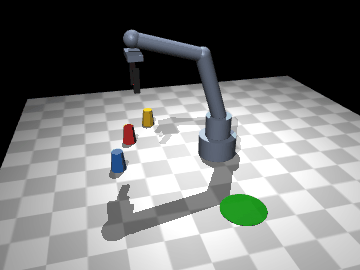
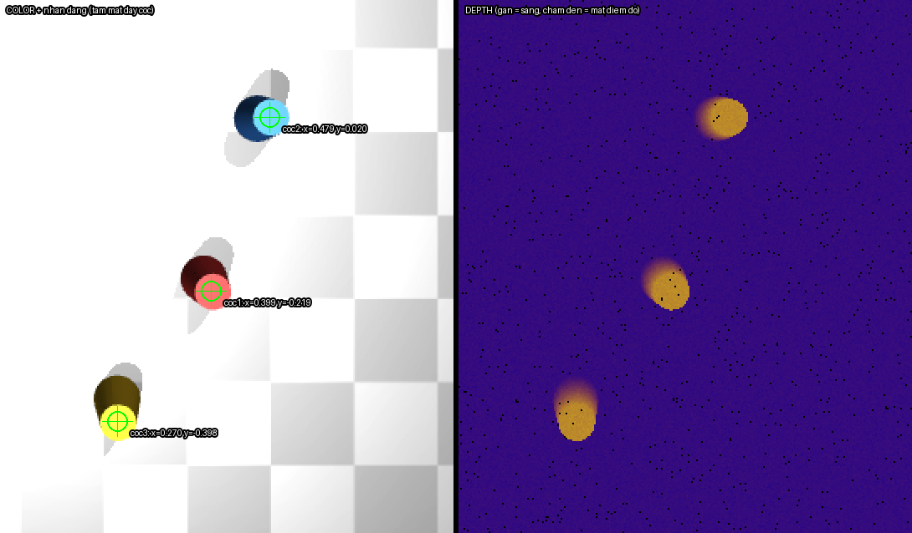

# Bài: Tìm cốc bằng camera RealSense + điều khiển vòng kín





Đây là phiên bản nâng cấp của [bài xếp cốc](../bai_xep_coc/). Ở bài trước, robot **hỏi thẳng mô phỏng** xem cốc ở đâu (`d.body(c).xpos`) và chỉ hỏi một lần lúc đầu. Ở bài này:

| | Bài xếp cốc | Bài này |
|---|---|---|
| Biết cốc ở đâu | đọc thẳng từ mô phỏng, chính xác tuyệt đối | **camera RealSense giả lập**: ảnh màu + ảnh độ sâu, có nhiễu |
| Bao giờ nhìn | 1 lần lúc đầu | **trước mỗi lần gắp** |
| Kẹp hụt | không biết | **phát hiện** qua độ mở ngón, rồi nhìn lại và gắp lại |
| Đặt cốc trên | vào vị trí dự kiến | vào giữa vị trí **đo thực tế** của 2 cốc dưới |

## Chạy thử

```bash
pip install -r ../bai_gap_do/requirements.txt
python xep_coc_camera.py                   # chạy bình thường
python xep_coc_camera.py --pha             # có "người phá" dời cốc khi tay đang làm
python xep_coc_camera.py --ngau-nhien 3    # rải cốc ngẫu nhiên
python xep_coc_camera.py --xem             # mở viewer
MUJOCO_GL=egl python xep_coc_camera.py --pha --gif   # xuất GIF + ảnh camera
```

Bài này import code từ `../bai_gap_do/` và `../bai_xep_coc/`, nên 3 thư mục cần để cạnh nhau. Camera cần render ảnh, nên trên máy không có màn hình phải đặt `MUJOCO_GL=egl`.

Kết quả với `--pha`:

```
== Cốc coc1 ==
  lần 1: camera thấy coc1 ở [ 0.399 -0.219 -0.   ] (sai số so với thật 1.7 mm)
    >>> NGƯỜI PHÁ: tay đang chở C1, dời coc3 tới [ 0.22 -0.3 ]
== Cốc coc2 ==
  lần 1: camera thấy coc2 ở [ 0.479  0.02  -0.   ] (sai số so với thật 1.4 mm)
== Cốc coc3 ==
  lần 1: camera thấy coc3 ở [ 0.221 -0.298 -0.   ] (sai số so với thật 2.7 mm)
    >>> NGƯỜI PHÁ: tay đang hạ xuống, dời coc3 tới [ 0.1 -0.3]
    ! kẹp hụt (ngón chỉ mở 0.0 mm) -> mở kẹp, nhìn lại
  lần 2: camera thấy coc3 ở [ 0.101 -0.298 -0.   ] (sai số so với thật 2.4 mm)
  camera đo C1, C2 -> đặt C3 tại [0.053 0.418 0.09 ] (dự kiến [0.05 0.42 0.09])
Chờ 2 s kiểm tra độ vững...
Kết quả:
  C1: ở [ 0.015  0.42  -0.   ], lệch  2.2 mm, nghiêng  0.0 độ -> ĐẠT
  C2: ở [ 0.089  0.42  -0.   ], lệch  1.9 mm, nghiêng  0.0 độ -> ĐẠT
  C3: ở [0.054 0.418 0.09 ], lệch  2.8 mm, nghiêng  0.0 độ -> ĐẠT
Kim tự tháp: ĐẠT
```

Đã kiểm chứng:

- Chạy thường với cốc rải ngẫu nhiên (seed 1–20): đạt **20/20**.
- Chạy `--pha` với cốc rải ngẫu nhiên (seed 1–20): đạt **20/20**. Lần nào cốc C3 cũng bị dời 2 lần và tay kẹp hụt 1 lần, rồi gắp lại trúng.
- Sai số vị trí cốc do camera đo, qua 60 lần đo: trung vị 1.7 mm, lớn nhất 2.9 mm.

| File | Nội dung |
|---|---|
| `realsense.py` | Class `CameraRealSense`: chụp color + depth có nhiễu, intrinsics, chiếu ngược điểm ảnh ra 3D |
| `nhan_dang.py` | Tìm cốc: lọc màu theo HSV, lấy mặt đáy cốc từ đám mây điểm 3D |
| `xep_coc_camera.py` | Gắn camera vào model, vòng điều khiển kín, kịch bản "phá" |

---

## 1. Gắn camera vào model bằng `MjSpec`

Thay vì chép lại cả file XML, ta nạp model của bài trước rồi **gắn thêm** camera bằng code:

```python
spec = mujoco.MjSpec.from_file("../bai_xep_coc/xep_coc.xml")
than = spec.worldbody.add_body(name="gia_camera", pos=[0.25, 0.0, 1.1])
than.add_camera(name="realsense", pos=[0, 0, -0.015], fovy=58)
m = spec.compile()
```

Camera MuJoCo mặc định nhìn theo trục −z, nên khi treo trên cao nó tự nhìn thẳng xuống bàn. `fovy=58` xấp xỉ góc nhìn dọc của RealSense D435.

## 2. Camera RealSense giả lập (`realsense.py`)

### 2.1 Ảnh độ sâu và nhiễu

`mujoco.Renderer` có chế độ `enable_depth_rendering()`, cho ra ảnh độ sâu tính bằng mét. Ảnh đó hoàn hảo, nên ta thêm nhiễu cho giống camera thật:

| Hiệu ứng | Cách giả lập | Ngoài đời |
|---|---|---|
| Nhiễu đo | Gauss, σ = 2 mm × z² | Camera stereo: sai số tăng theo bình phương khoảng cách |
| Lượng tử | làm tròn 1 mm | D435 xuất depth dạng `uint16`, đơn vị 1 mm |
| Điểm thủng | 1% điểm ảnh = 0 | Mép vật, mặt bóng/tối: không đo được |

### 2.2 Chiếu ngược: điểm ảnh → toạ độ 3D

Thông số nội (intrinsics) tính từ góc nhìn:

```
fy = (H/2) / tan(fovy/2),   fx = fy,   cx = (W-1)/2,   cy = (H-1)/2
```

Một điểm ảnh (u, v) có độ sâu z ứng với điểm trong hệ camera:

```
x =  (u - cx) · z / fx
y = -(v - cy) · z / fy      ← dấu trừ: hệ camera MuJoCo có y hướng LÊN
z_cam = -z                  ← camera MuJoCo nhìn theo -z
```

Hệ camera của RealSense/OpenCV thì y hướng xuống và camera nhìn theo +z, nên khi chuyển sang camera thật, chỉ cần bỏ 2 dấu trừ này. Sau đó đổi sang hệ thế giới:

```
p_world = R_cam · p_cam + t_cam
```

`R_cam` và `t_cam` là **thông số ngoại** (extrinsics). Trong mô phỏng ta đọc thẳng (`d.cam_xmat`, `d.cam_xpos`). Ngoài đời phải đo bằng **hiệu chỉnh tay–mắt** (hand-eye calibration), ví dụ cho robot cầm bảng ArUco tới nhiều tư thế rồi giải hệ phương trình.

## 3. Tìm cốc (`nhan_dang.py`)

```
ảnh màu ──► lọc HSV ──► mặt nạ từng màu ──┐
                                          ├─► điểm 3D ──► giữ điểm cao nhất ──► trung vị = tâm đáy cốc
ảnh depth ────────────────────────────────┘
```

1. **Lọc màu theo hue (HSV).** Mỗi cốc có một khoảng hue riêng. Lọc theo hue bền với thay đổi sáng/tối hơn nhiều so với lọc theo giá trị RGB (xem lỗi 3 ở mục 5).
2. **Chiếu ngược** mọi điểm ảnh trong mặt nạ ra 3D.
3. **Chỉ giữ điểm cao nhất** (cách đỉnh ≤ 1 cm). Từ trên nhìn xuống, ta thấy cả mặt đáy lẫn một phần thành cốc nghiêng, nhưng chỉ tâm của **mặt đáy** mới nằm đúng trên trục cốc.
4. **Lấy trung vị (median)** thay vì trung bình, để các điểm nhiễu và điểm thủng không kéo lệch kết quả.
5. Gốc cốc = tâm đáy − chiều cao cốc (9 cm).

## 4. Vòng điều khiển kín

```
for mỗi cốc:
    lặp tối đa 3 lần:
        lùi tay về tư thế chờ ─► chụp ảnh ─► tìm cốc      (NHÌN LẠI mỗi lần)
        gắp
        nếu ngón đóng < 1 cm: kẹp hụt ─► mở kẹp, quay lại  (KIỂM TRA)
        ngược lại: thoát vòng lặp
    nếu là cốc trên cùng: đích = giữa vị trí ĐO ĐƯỢC của C1, C2
    đặt
```

- **Tư thế chờ** được cho bằng *góc khớp*: tay dựng gần thẳng đứng. Nhìn từ trên xuống, tay chỉ chiếm vùng quanh đế, không che cốc.
- **Phát hiện kẹp hụt** không cần cảm biến thêm: nếu giữa 2 ngón có cốc, ngón dừng lại ở độ mở khoảng 3 cm; nếu không có gì, ngón đóng hẳn về 0. Kẹp công nghiệp thật cũng làm đúng như vậy.
- **Kịch bản `--pha`:** (1) đang chở C1 thì C3 bị dời đi chỗ khác. Nhờ nhìn lại trước khi gắp, tay vẫn tới đúng chỗ mới. (2) Đúng lúc tay hạ xuống gắp C3, cốc lại bị kéo đi 12 cm. Tay kẹp hụt, phát hiện ra, nhìn lại và gắp lần 2.

---

## 5. Những lỗi đã gặp khi viết bài

### Lỗi 1: Camera nhận nhầm chấm đánh dấu TCP là cốc đỏ
Site `tcp` được vẽ thành một chấm đỏ trong viewer, và camera ảo cũng chụp được nó. Camera thật thì không thấy những thứ chỉ dùng để hiển thị như vậy. **Sửa:** dùng `MjvOption` với `sitegroup[:] = 0` để tắt hiển thị site khi camera chụp.

### Lỗi 2: IK rơi vào nhánh nghiệm xấu
Lúc đầu, tư thế chờ được cho bằng vị trí TCP ở **sau lưng đế**. Từ đó đi tới cốc phía trước, IK chạy tiếp từ nghiệm cũ, nên đế vẫn quay ra sau và cánh tay vươn lật qua đầu, chạm giới hạn khớp. Kết quả là tay kẹp hụt cả 3 lần dù camera đo đúng.
**Sửa:** tư thế chờ cho bằng góc khớp. Các quãng dài thì nội suy **trong không gian khớp** (`toi_khop`), với nghiệm IK được giải từ điểm khởi đầu hợp lý: đế quay đúng về phía đích (`giai_ik_moi`).
**Bài học:** IK cục bộ (như DLS) chỉ tìm nghiệm *gần* điểm khởi đầu. Muốn được nghiệm tốt thì phải chọn điểm khởi đầu tốt.

### Lỗi 3: Lọc màu theo RGB làm mất mặt sáng của cốc
Luật ban đầu cho màu xanh là "b > 1.6·r và b > 1.2·g". Mặt đáy cốc xanh hướng về đèn có màu xanh lơ, khoảng (130, 220, 255), nên không thoả `b > 1.2·g`. Kết quả là mặt nạ chỉ còn phần thành cốc trong bóng tối, và vị trí cốc bị đo lệch 2 cm.
**Sửa:** chuyển sang lọc theo hue, rồi **đo hue thật** của mặt đáy cốc trên 30 ảnh với cốc ở vị trí ngẫu nhiên: đỏ 0–37°, vàng 37–60°, xanh 180–205°. Ngưỡng ban đầu (xanh 190–240°) đã cắt mất một nửa.
**Bài học:** đừng đoán ngưỡng; hãy đo trên dữ liệu thật. Ngoài đời, ánh sáng phòng còn thay đổi nhiều hơn mô phỏng.

### Lỗi 4: Kịch bản kiểm thử tự gây lỗi
Hàm "phá" ban đầu dời C3 tới các toạ độ cố định. Có lúc chỗ đó đã có cốc khác, nên 2 cốc bị đặt chồng lấn. Có lúc chỗ đó lại nằm ngoài tầm với (0.54 m), nên IK báo lỗi. Ở cả hai trường hợp, robot không làm gì sai.
**Sửa:** chỉ dời cốc tới chỗ còn trống (cách cốc khác ≥ 14 cm) và nằm trong vùng 0.3–0.46 m.
**Bài học:** khi test hỏng, phải kiểm tra **cả code kiểm thử**, không chỉ code chính.

---

## 5b. Bản nâng cấp (`--nang-cap`)

```bash
MUJOCO_GL=egl python xep_coc_camera.py --nang-cap
```

- Gắn 2 marker hồng lên mu bàn tay.
- **Tự hiệu chỉnh** khi khởi động (`tu_hieu_chinh.py`): ước lượng đồng thời độ lệch encoder và sai số camera.
- **Chỉnh tay bằng camera** trước khi gắp và trước khi thả.
- **Phát hiện rơi cốc** sau khi nhấc và khi tới đích.

Nhờ vậy, hệ chịu được encoder lệch tới 2° và hiệu chỉnh tay–mắt sai tới 40 mm / 2° mà tháp vẫn đứng ≥ 95%. Bản cũ chỉ chịu được 0.5° và 15 mm / 1°. Số liệu chi tiết ở [bài thử độ bền](../bai_do_ben/README.md#5-nâng-cấp-và-so-sánh-trước--sau).

## 6. Chuyển sang RealSense thật

Phần xử lý ảnh (`nhan_dang.py`) giữ nguyên. Chỉ cần thay class `CameraRealSense` bằng một class đọc từ camera thật có cùng giao diện `chup()` và `chieu_nguoc()`:

```python
import pyrealsense2 as rs
pipe, cfg = rs.pipeline(), rs.config()
cfg.enable_stream(rs.stream.color, 640, 480, rs.format.rgb8, 30)
cfg.enable_stream(rs.stream.depth, 640, 480, rs.format.z16, 30)
prof = pipe.start(cfg)
align = rs.align(rs.stream.color)                     # căn depth theo ảnh màu
scale = prof.get_device().first_depth_sensor().get_depth_scale()   # thường 0.001

frames = align.process(pipe.wait_for_frames())
color = np.asanyarray(frames.get_color_frame().get_data())
depth = np.asanyarray(frames.get_depth_frame().get_data()) * scale   # -> mét
intr = frames.get_color_frame().profile.as_video_stream_profile().intrinsics
# intr.fx, intr.fy, intr.ppx (= cx), intr.ppy (= cy)
# Chú ý: hệ camera RealSense có y hướng xuống, nhìn theo +z -> bỏ 2 dấu trừ trong chieu_nguoc
```

Đoạn này mình chưa chạy được vì trong môi trường này không có camera thật.

Những điều cần làm thêm ngoài đời:

- **Hiệu chỉnh tay–mắt** để có `R_cam` và `t_cam` chính xác.
- **Đo lại ngưỡng HSV** dưới ánh sáng phòng thật.
- Bật các bộ lọc của RealSense (`spatial`, `temporal`, `hole_filling`) để giảm nhiễu và lấp lỗ.

## 7. Bài tập

1. **Tăng nhiễu:** tăng `nhieu` lên 0.01 và `ti_le_thung` lên 0.1. Sai số đo tăng bao nhiêu? Robot còn xếp được không?
2. **Bỏ bước "giữ điểm cao nhất"** trong `tim_coc` và lấy trung vị của mọi điểm. Sai số thay đổi thế nào? Vì sao?
3. **Camera nghiêng:** dời camera sang bên và cho nghiêng 30° (dùng `xyaxes` hoặc `quat` khi `add_camera`). Code có cần sửa gì không?
4. **Cốc cùng màu:** đổi cả 3 cốc thành màu đỏ. Hãy tách các cốc bằng thuật toán gom cụm (connected components) trên mặt nạ.
5. **Nhìn trong lúc di chuyển:** thay vì lùi tay về tư thế chờ, chỉ chụp khi tay không che cốc cần gắp. Kiểm tra điều kiện này bằng cách chiếu xuôi (`chieu_xuoi`) các khâu của tay lên ảnh.
6. **Phát hiện cốc đổ:** từ đám mây điểm 3D, hãy phát hiện một cốc đang nằm nghiêng (mặt trên không còn nằm ngang).
