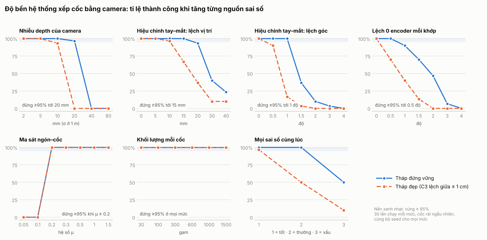
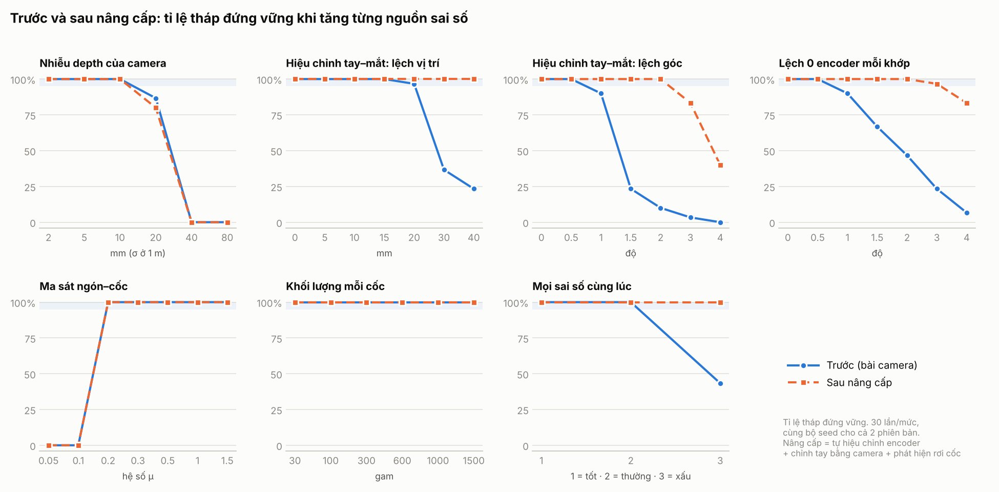

# Bài: Thử độ bền hệ thống xếp cốc bằng camera



> **Cập nhật:** đã làm bản nâng cấp sửa các điểm yếu tìm ra ở đây. So sánh trước/sau ở [mục 5](#5-nâng-cấp-và-so-sánh-trước--sau).

Bài [camera](../bai_camera/) xếp tháp thành công 400/400 lần **trong mô phỏng lý tưởng**. Robot thật thì luôn có sai số. Bài này trả lời câu hỏi: *mỗi loại sai số được phép lớn tới đâu thì tháp vẫn đứng?*

Cách làm:

- Với mỗi **nguồn sai số**, tăng dần **mức độ**.
- Ở mỗi mức, chạy 30 lần với cốc rải ngẫu nhiên. Mọi mức dùng **cùng một bộ seed**, nên khác biệt giữa các mức chỉ đến từ sai số.
- Tổng cộng 1.290 lần chạy, mất khoảng 9 phút trên 4 nhân (bản nâng cấp: khoảng 90 phút, vì có thêm bước tự hiệu chỉnh và chụp nhiều ảnh hơn). Không lần nào mô phỏng bị nổ.
- Camera treo ở độ cao 1.25 m (dời lên từ 1.1 m để thấy được bàn tay khi ở trên tháp, cần cho bản nâng cấp). Các số liệu dưới đây đều đo với vị trí camera này.

```bash
pip install matplotlib
MUJOCO_GL=egl python thu_do_ben.py           # chạy đầy đủ -> ket_qua.csv
MUJOCO_GL=egl python thu_do_ben.py --nang-cap   # bản nâng cấp -> ket_qua_nang_cap.csv
MUJOCO_GL=egl python thu_do_ben.py --nhanh   # 6 lần/mức, ~2 phút
python ve_bieu_do.py                          # -> do_ben.png (+ so_sanh.png nếu có kết quả nâng cấp)
```

| File | Nội dung |
|---|---|
| `thu_do_ben.py` | Các hàm bơm sai số, chạy song song, chấm điểm, ghi `ket_qua.csv` |
| `ve_bieu_do.py` | Vẽ `do_ben.png` |
| `ket_qua.csv` | Dữ liệu thô: mỗi dòng = 1 lần chạy (nguồn, mức, seed, đạt?, lý do hỏng, các chỉ số) |

## 1. Thế nào là "thành công"?

Bài camera tính "đạt" khi mỗi cốc nằm cách **toạ độ đích tuyệt đối** dưới 8 mm. Tiêu chí đó quá khắt khe cho câu hỏi ở đây, vì cả tháp dịch đi 1 cm thì vẫn là một cái tháp tốt. Ở bản chạy thử đầu tiên, phần lớn các lần bị tính "hỏng" thật ra tháp vẫn đứng ngon lành. Vì vậy bài này dùng 2 chỉ số:

- **Tháp đứng vững** (chỉ số chính, thuần vật lý): sau khi chờ 2 s,
  - không cốc nào nghiêng quá 3°,
  - C1, C2 nằm trên sàn và không chồng lấn,
  - C3 nằm ở tầng 2 (z = 9 cm ± 5 mm), tức là đang được C1 và C2 đỡ.
- **Tháp đẹp**: đứng vững, và thêm điều kiện C3 lệch khỏi điểm giữa C1–C2 không quá 1 cm.

Mỗi lần hỏng được ghi kèm lý do:

| Lý do | Ý nghĩa |
|---|---|
| `coc_do` | có cốc bị đổ |
| `C3_roi` | C3 không nằm trên tầng 2 |
| `tang1_sai` | C1, C2 sai vị trí hoặc chồng lấn |
| `kep_hut_3_lan` | gắp hụt 3 lần liên tiếp |
| `camera_khong_thay` | camera không tìm thấy cốc |
| `loi_AssertionError` | IK không hội tụ: đích nằm ngoài tầm với |

## 2. Các nguồn sai số và cách giả lập

| Nguồn | Giả lập thế nào | Ngoài đời |
|---|---|---|
| Nhiễu depth | tăng σ nhiễu của `CameraRealSense` | D435: khoảng 1–2% khoảng cách. Tệ hơn với mặt bóng, tối hoặc nắng chiếu |
| Tay–mắt: lệch vị trí | robot tưởng camera đặt lệch `t` mm (hướng ngẫu nhiên) | sai số hiệu chỉnh tay–mắt, giá camera bị xô |
| Tay–mắt: lệch góc | robot tưởng camera nghiêng thêm θ độ (trục ngẫu nhiên) | như trên. Nghiêng 1° ở độ cao 1.1 m làm điểm đo dịch khoảng 19 mm |
| Lệch encoder | mỗi khớp lệch ±δ độ, dấu ngẫu nhiên. Robot ra lệnh góc q nhưng thực tế đứng ở q + δ | hiệu chỉnh điểm 0 sai, độ rơ hộp số, khâu bị uốn |
| Ma sát ngón–cốc | đặt μ cho cả ngón lẫn cốc (MuJoCo lấy giá trị **lớn hơn** của 2 geom) | cốc nhựa trơn hoặc ướt, đệm ngón bị mòn |
| Khối lượng cốc | đổi `body_mass` và `body_inertia`, rồi **gọi `mj_setConst`** | cốc rỗng ~30 g, cốc có nước 200–300 g |
| Kết hợp | mọi nguồn cùng lúc, theo 3 cấp (bảng dưới) | |

| Cấp kết hợp | Nhiễu (mm @1 m) | Tay–mắt dịch | Tay–mắt xoay | Encoder | μ | Khối lượng |
|---|---|---|---|---|---|---|
| 1 = tốt | 2 | 2 mm | 0.2° | 0.2° | 1.0 | 30 g |
| 2 = bình thường | 4 | 5 mm | 0.5° | 0.5° | 0.7 | 60 g |
| 3 = xấu | 8 | 10 mm | 1.0° | 1.0° | 0.5 | 100 g |

## 3. Kết quả

| Nguồn sai số | Tháp đứng ≥ 95% khi | Gãy ở đâu |
|---|---|---|
| Nhiễu depth | σ ≤ 10 mm @1 m | 20 mm: 83%, 40 mm: 0% |
| Tay–mắt: lệch vị trí | ≤ 15 mm | 20 mm: 93%, 30 mm: 43% |
| Tay–mắt: lệch góc | ≤ 1° | 1.5°: 23%, 2°: 10% |
| Lệch encoder | ≤ 0.5° mỗi khớp | 1°: 90%, 1.5°: 70%, 2°: 43% |
| Ma sát ngón–cốc | μ ≥ 0.2 | μ = 0.1: 0% |
| Khối lượng cốc | mọi mức tới 1.5 kg | không gãy |
| **Kết hợp** | cấp 1 và cấp 2: **100%** | cấp 3: 43% |

Với tiêu chí "tháp đẹp", các ngưỡng chặt hơn nhiều. Ví dụ: encoder lệch 0.5° thì tháp vẫn đứng 100%, nhưng chỉ đẹp 70%. Ở cấp kết hợp 2, tháp đứng 100% nhưng chỉ đẹp 43%.

### 3.1 Sai số GÓC là nguy hiểm nhất, vì có cánh tay đòn

Lệch 1° nghe rất nhỏ, nhưng nó bị khuếch đại bởi khoảng cách:

- Camera treo cao 1.25 m: lệch 1° → điểm đo dịch `1.25 × tan 1°` ≈ **22 mm**.
- Cánh tay dài khoảng 0.6 m: mỗi khớp lệch 0.5° → TCP dịch ≈ **5 mm**. 5 khớp cùng lệch thì sai số cộng dồn.

So sánh: lệch *vị trí* camera 15 mm thì tháp vẫn đứng 100%, trong khi lệch *góc* chỉ 1.5° (≈ 33 mm ở mặt bàn, camera cao 1.25 m) thì tháp chỉ đứng 23%.

**Bài học khi lên robot thật:** khi hiệu chỉnh tay–mắt, góc quan trọng hơn vị trí. Encoder cần được hiệu chỉnh điểm 0 tới mức dưới 0.5°.

### 3.2 Camera sửa được lỗi khi GẮP, nhưng không sửa được lỗi khi ĐẶT

Vòng kín của bài camera chỉ đo vị trí **cốc**, chứ không đo vị trí **tay**. Khi encoder lệch:

- **Gắp:** tay tới lệch vài mm, nhưng ngón kẹp đang mở rộng hơn cốc 1.5 cm mỗi bên nên vẫn gắp được. Khi đóng, 2 ngón tự kéo cốc vào giữa theo phương kẹp.
- **Đặt:** tay đặt cốc ở chỗ *nó tưởng* là đích, nhưng thật ra lệch đi. Không có gì kiểm tra lại bước này.
- **Đặt C3:** camera đo đúng C1, C2 ở đâu, nhưng tay vẫn đặt C3 lệch theo sai số encoder. Lúc này camera và cánh tay "không đồng ý" với nhau về toạ độ.

Cách khắc phục là **visual servoing**: cho camera nhìn cả bàn tay (hoặc cốc đang cầm) ngay trước khi thả, rồi chỉnh theo độ lệch nhìn thấy (bài tập 1).

### 3.3 Ma sát: ranh giới sắc do hiệu ứng nêm

Ma sát 0.2 thì đạt 100%, còn 0.1 thì hỏng 30/30, không có vùng chuyển tiếp. Lý do: thành cốc nghiêng một góc α với

```
tan α = (R_miệng − R_đáy) / cao = (35 − 25) / 90 = 0.111
```

Khi 2 ngón bóp một vật hình nêm, lực kẹp N có một thành phần `N·sin α` đẩy cốc trượt về phía đầu nhỏ, giống như bóp hạt dưa. Ma sát phải thắng được cả lực đó lẫn trọng lượng cốc:

```
μ ≥ tan α + m·g / (2·N·cos α) ≈ 0.111 + 0.29 / 40 ≈ 0.118
```

Đo trong mô phỏng (cốc C1, seed 1): μ = 0.13 thì giữ được cốc; μ = 0.115 thì cốc tuột khỏi kẹp ngay khi nhấc lên. Ranh giới đo được nằm giữa 0.115 và 0.13, khớp với công thức.

Hệ quả thực tế:

- Kẹp cốc ở đoạn **thẳng** hơn, hoặc dùng ngón có rãnh ôm theo độ nghiêng của cốc.
- Lực kẹp lớn **không** giúp được, vì tan α không phụ thuộc lực kẹp.
- Khối lượng ảnh hưởng rất ít (số hạng thứ hai rất nhỏ). Đó là lý do cốc nặng tới 1.5 kg vẫn đạt 100%.

### 3.4 Lỗ hổng phát hiện được: robot không biết mình làm rơi cốc

Ở μ = 0.1, khi đóng kẹp, ngón chạm vào cốc nên độ mở ngón khoảng 3 cm, và robot tưởng là **kẹp được**. Cốc tuột ngay khi nhấc lên, nhưng robot vẫn "chở" một cái kẹp rỗng sang đích, "đặt" xuống, rồi đi lấy cốc tiếp theo.

Nguyên nhân là bài camera chỉ kiểm tra độ mở ngón *trước* khi nhấc. Phải kiểm tra lại *sau* khi nhấc: lúc đó nếu cốc đã tuột thì ngón đóng sập về 0 (bài tập 2).

### 3.5 Nhiễu lớn làm hỏng thuật toán tìm mặt đáy

`tim_coc` chỉ giữ các điểm nằm trong khoảng 1 cm tính từ điểm cao nhất, để lấy đúng mặt đáy cốc. Khi nhiễu depth vượt 1 cm, cửa sổ này chứa toàn điểm nhiễu ngẫu nhiên, nên độ cao cốc đo sai. Kết quả là C3 bị thả từ quá cao (`C3_roi`) hoặc ép vào tháp làm đổ. Ở nhiễu 80 mm thì không tìm được mặt đáy nữa và gắp hụt cả 3 lần.

Cách sửa: dùng chiều cao cốc đã biết (9 cm) thay vì đo, hoặc fit mặt phẳng bằng RANSAC (bài tập 3).

## 4. "Ngân sách sai số" cho robot thật

Từ kết quả trên, muốn tháp đứng ≥ 95% thì mỗi nguồn sai số **riêng lẻ** phải nằm trong:

```
nhiễu depth      ≤ 10 mm @ 1 m   (D435 trong điều kiện tốt: ~10-20 mm @ 1 m -> sát giới hạn)
tay–mắt vị trí   ≤ 15 mm
tay–mắt góc      ≤ 1°            <- khó nhất, cần hiệu chỉnh cẩn thận
encoder          ≤ 0.5° mỗi khớp <- khó với servo rẻ tiền (độ rơ hộp số thường 0.5–1°)
ma sát ngón–cốc  ≥ 0.2           (≥ 0.12 về lý thuyết; cốc nhựa ướt có thể thấp hơn)
```

Khi mọi nguồn **cùng có mặt** thì sai số cộng dồn. Cấp 2 ("bình thường", mỗi nguồn ở khoảng 1/2 tới 1/3 ngưỡng) vẫn đứng 100%. Cấp 3 (mỗi nguồn ở khoảng 1/2 tới 1 ngưỡng) chỉ còn 43%.

**Kết luận:**

- Với robot giá rẻ (servo hobby, độ rơ ~1°), nên kỳ vọng tỷ lệ thành công khoảng **50–90%** nếu giữ nguyên thuật toán hiện tại.
- Muốn cao hơn thì phải để camera đo cả bàn tay, chứ không chỉ mua camera tốt hơn. Bản nâng cấp ở mục 5 làm đúng việc đó.

Lưu ý: đây là ước lượng từ mô phỏng. Mô phỏng vẫn còn bỏ qua nhiều thứ, như cốc mềm bị bóp méo, ánh sáng thay đổi, rung động và độ trễ điều khiển. Con số thật cần được đo trên robot thật.

## 5. Nâng cấp và so sánh trước / sau



Bản nâng cấp (bật bằng `nang_cap=True` / `--nang-cap` trong `../bai_camera/xep_coc_camera.py`) sửa các điểm yếu tìm được ở mục 3:

1. **Phát hiện rơi cốc** (sửa mục 3.4): kiểm tra độ mở ngón cả *sau khi nhấc* và *khi tới trên đích*. Nếu cốc đã tuột thì quay lại nhìn và gắp lại.
2. **Gắn 2 marker màu hồng lên mu bàn tay** để camera đo được vị trí *thật* của tay.
3. **Tự hiệu chỉnh khi khởi động** (`../bai_camera/tu_hieu_chinh.py`): tay đi qua 12 tư thế, camera đo marker, rồi giải Gauss-Newton để ước lượng **đồng thời** độ lệch encoder từng khớp và sai số vị trí/góc của camera. Từ đó về sau, mọi lệnh điều khiển và mọi điểm camera đo đều được bù.
4. **Chỉnh tay bằng camera** (visual servoing) trước khi gắp và trước khi thả: đo vị trí tay, rồi dịch tay tới khi lệch dưới 1.5 mm. Mỗi lần đo lọc qua 3 ảnh; lần đo nào bảo phải dịch quá 2 cm thì bỏ qua.

### 5.1 Kết quả (tháp đứng vững, 30 lần/mức, cùng bộ seed)

| Nguồn sai số | Mức | Trước | Sau |
|---|---|---|---|
| Tay–mắt: lệch vị trí | 30 mm | 43% | **100%** |
| | 40 mm | 23% | **97%** |
| Tay–mắt: lệch góc | 1.5° | 23% | **100%** |
| | 2° | 10% | **100%** |
| | 3° | 3% | **67%** |
| Lệch encoder | 2° | 43% | **100%** |
| | 3° | 13% | **93%** |
| | 4° | 0% | **73%** |
| **Mọi sai số cùng lúc** | cấp 3 (xấu) | 43% | **100%** |
| Nhiễu depth | 20 mm | 83% | 80% (như nhau) |
| Ma sát | μ = 0.1 | 0% | 0% (giới hạn vật lý, nhưng giờ robot **biết** mình làm rơi) |
| Khối lượng | mọi mức | 100% | 100% |

**Ngân sách sai số mới** (tháp đứng ≥ 95%):

| Nguồn | Trước | Sau |
|---|---|---|
| Tay–mắt: vị trí | ≤ 15 mm | **≤ 40 mm** |
| Tay–mắt: góc | ≤ 1° | **≤ 2°** |
| Encoder | ≤ 0.5° | **≤ 2°** |

Nói cách khác, bản nâng cấp **dư sức chịu độ rơ của servo giá rẻ** (0.5–1°), và cho phép hiệu chỉnh tay–mắt sơ sài hơn nhiều. Chỉ số "tháp đẹp" cũng tăng mạnh: ở cấp kết hợp 2, từ 43% lên 87%.

**Không cải thiện:**
- **Nhiễu camera:** việc tìm cốc vẫn dùng chung thuật toán cũ, và đây đang là giới hạn còn lại (bài tập 3).
- **Ma sát thấp:** là giới hạn vật lý của hiệu ứng nêm. Khác biệt là giờ robot báo đúng lý do (gắp hụt 3 lần) thay vì "tưởng" đã xếp xong.

### 5.2 Những bài học khi làm bản nâng cấp

1. **Camera phải nhìn thấy được thứ cần đo.** Bản đầu, camera ở độ cao 1.1 m không thấy bàn tay khi tay ở trên tháp (ra ngoài khung hình), nên bước chỉnh tay âm thầm bị bỏ qua. Phải dời camera lên 1.25 m.
2. **Cẳng tay che marker.** Với một số hướng tiếp cận, cẳng tay che mất 1 trong 2 marker. Vì hướng bàn tay đã biết, chỉ cần thấy 1 marker cũng suy ra được tâm tay.
3. **Chỉnh tay đúng chỗ là chưa đủ, vì tay còn nghiêng.** Encoder lệch làm tay vừa dịch vừa nghiêng (3 khớp gập cùng lệch 1.5° thành nghiêng 4.5°). Marker nằm cao hơn TCP 13 cm, nên căn đúng marker vẫn lệch cốc khoảng 10 mm. Vì vậy phải **hiệu chỉnh mô hình động học**, chứ không chỉ chỉnh từng điểm.
4. **Đừng đổ mọi sai số cho một nguồn.** Bản tự hiệu chỉnh đầu tiên chỉ ước lượng lệch encoder. Khi camera bị đặt lệch, nó "bịa" ra độ lệch khớp để khớp số đo, làm tay nghiêng, và kết quả **tệ hơn cả bản cũ** (tay–mắt lệch 10 mm: 100% → 63%). Ước lượng đồng thời encoder + camera mới đúng.
5. **Tham số khó quan sát cần ràng buộc mạnh.** Marker gắn sát cổ tay, nên khớp cổ tay quay một chút thì marker gần như không đổi, nhưng TCP thì dịch nhiều. Dù không có sai số nào, ước lượng vẫn ra cổ tay lệch −1.6°. Phải đặt ràng buộc kéo các khớp cổ tay về 0. Cái giá là: khi cổ tay lệch thật 4°, hệ chỉ bù được một phần (encoder 4°: 73%). Muốn tốt hơn thì gắn marker xa cổ tay hơn.
6. **Phải đo, không đoán.** Bản nâng cấp đầu tiên "nghe rất hợp lý", nhưng bộ thử độ bền cho thấy nó tệ hơn ở 4 trên 7 nguồn sai số. Không có bộ thử này thì đã gửi đi một bản lỗi.

## 6. Những điều rút ra khi viết bài

1. **Đổi khối lượng xong phải gọi `mj_setConst(m, d)`.** Ở bản đầu, cốc nặng 300 g trở lên làm mô phỏng nổ (NaN), MuJoCo tự reset, và robot trông như "gắp hụt". Thật ra robot không làm gì sai: model đang dùng các hằng số tính cho khối lượng cũ. Script giờ kiểm tra `d.warning[mjWARN_BADQACC]` để tách các lần mô phỏng nổ ra khỏi lỗi của robot (với code đã sửa thì không còn lần nào).
2. **Chọn tiêu chí đúng câu hỏi.** Tiêu chí "lệch ≤ 8 mm so với toạ độ tuyệt đối" cho ra kết quả bi quan sai lệch (encoder 0.5° → 33%). Tiêu chí "tháp đứng" cho 100%. Cả hai đều có ích, nhưng phải biết mình đang đo cái gì.
3. **Dùng cùng một bộ seed cho mọi mức** (common random numbers). Nhờ vậy, khác biệt giữa 2 mức đến từ sai số chứ không phải do lần này cốc rải dễ hơn lần kia.

## 7. Bài tập

1. ~~**Visual servoing khi đặt:**~~ *(đã làm: mục 5)* trước khi thả C3, chụp ảnh, đo vị trí cốc C3 đang cầm so với C1 và C2, rồi dịch tay để bù độ lệch. Sau đó chạy lại `lech_encoder` xem ngưỡng tăng được bao nhiêu.
2. ~~**Phát hiện rơi cốc:**~~ *(đã làm: mục 5)* kiểm tra độ mở ngón sau khi nhấc và trong lúc chở. Nếu cốc tuột thì quay lại gắp. Chạy lại ô `ma_sat_kep`: lý do hỏng có đổi từ `C3_roi` sang `kep_hut_3_lan` không? Có lần nào cứu được không?
3. **Tìm mặt đáy bền hơn:** thay cửa sổ 1 cm trong `tim_coc` bằng RANSAC fit mặt phẳng ngang, hoặc dùng chiều cao cốc đã biết. Chạy lại ô `nhieu_camera`.
4. **Ngón kẹp tốt hơn:** đổi ngón thành hình nêm nghiêng đúng góc α của cốc. Ranh giới ma sát còn không?
5. **Nguồn sai số mới:** thêm độ trễ camera (robot dùng ảnh chụp từ 0.3 s trước) và độ rơ (backlash) ở khớp. Viết hàm bơm sai số theo mẫu `lech_encoder`.
6. **Thống kê:** mỗi mức hiện chỉ có 30 lần chạy. Hãy tính khoảng tin cậy 95% (Wilson) cho mỗi điểm và vẽ thành dải mờ quanh đường. Mức nào cần chạy thêm?

## 8. Kết quả với cánh tay 6DOF

`ket_qua.csv`, `ket_qua_nang_cap.csv` và các biểu đồ hiện tại là dữ liệu **6DOF**. Dữ liệu 5DOF giữ trong `ket_qua_5dof.csv`, `ket_qua_nang_cap_5dof.csv`. So sánh: `so_sanh_5dof_6dof.png`.

**Bản nâng cấp 6DOF bằng hoặc hơn 5DOF ở mọi ô** (30 lần/mức, cùng seed):

| Nguồn | 5DOF | 6DOF |
|---|---|---|
| Lệch encoder 3° | 93% | 97% |
| Lệch encoder 4° | 73% | 83% |
| Lệch góc tay–mắt 3° | 67% | 83% |
| Lệch góc tay–mắt 4° | 30% | 40% |
| Nhiễu camera 10 mm | 97% | 100% |
| Lệch vị trí tay–mắt 40 mm | 97% | 100% |
| Các ô còn lại | bằng nhau | bằng nhau |

Lần chạy 6DOF đầu tiên kém hơn 5DOF (encoder 4°: 43%, nhiễu 20 mm: 67%). Hai bài học:

1. **Khớp không quan sát được thì không hiệu chỉnh được.** Hai marker nằm dọc trục khớp gập cổ tay nên khớp này lệch thì marker gần như đứng yên. Bơm lệch 4° vào từng khớp riêng cho thấy chỉ khớp này làm cốc đổ. Sửa: một nửa tư thế hiệu chỉnh xoay bàn tay 90°, khi đó lệch 4° làm 2 marker chênh cao ~7 mm, đo được.
2. **Mức tin số đo phải theo độ nhiễu.** Chênh vài mm giữa 2 marker bị nhiễu depth làm giả. Camera nhiễu thì robot "thấy" cổ tay lệch −1° dù không lệch. Robot tự đo nhiễu (độ phân tán giữa 3 khung hình cùng tư thế, camera sạch ~0 mm, nhiễu 20 mm ~1,3 mm) và giảm mức tin ước lượng cổ tay khi camera nhiễu.
