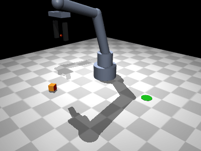

# Bài: Cánh tay robot gắp và đặt vật trong MuJoCo



Trong bài này, một cánh tay 5 bậc tự do có kẹp 2 ngón sẽ:

1. đọc vị trí và góc xoay của khối hộp,
2. xoay bàn tay cho 2 ngón song song với mặt khối,
3. hạ xuống, kẹp, nhấc lên,
4. chở khối sang vòng tròn xanh và đặt xuống.

Vật được giữ **hoàn toàn bằng ma sát** giữa ngón và vật. Bài không dùng mẹo `weld` để dính vật vào tay, nên các vấn đề vật lý thật (trượt, lực kẹp, độ mềm của tiếp xúc) đều xuất hiện, và chính chúng là phần đáng học nhất.

## Chạy thử

```bash
pip install -r requirements.txt
python gap_do.py                  # chạy không giao diện, in kết quả từng bước
python gap_do.py --xem            # mở viewer MuJoCo để xem trực tiếp
python gap_do.py --ngau-nhien 7   # vật ở vị trí + góc xoay ngẫu nhiên
MUJOCO_GL=egl python gap_do.py --gif   # xuất gap_do.gif trên máy không có màn hình
```

Kết quả mẫu:

```
Vật ở [ 0.42 -0.1   0.02], xoay 30.0 độ; đích [0.05 0.42]
  toi_tren_vat  xong | vật z=0.020 m | TCP lệch đích   0.0 mm | IK sai số max 0.10 mm
  ha_xuong      xong | vật z=0.020 m | TCP lệch đích   0.1 mm | IK sai số max 0.10 mm
  kep           xong | vật z=0.020 m | TCP lệch đích   0.1 mm | IK sai số max 0.08 mm
  nhac_len      xong | vật z=0.144 m | TCP lệch đích   0.7 mm | IK sai số max 0.10 mm
  di_chuyen     xong | vật z=0.144 m | TCP lệch đích   0.6 mm | IK sai số max 0.10 mm
  ha_dat        xong | vật z=0.023 m | TCP lệch đích   0.6 mm | IK sai số max 0.10 mm
  tha           xong | vật z=0.020 m | TCP lệch đích   0.0 mm | IK sai số max 0.08 mm
  rut_len       xong | vật z=0.020 m | TCP lệch đích   0.1 mm | IK sai số max 0.10 mm

Kết quả: vật được nhấc lên 0.144 m khi di chuyển -> ĐẠT
         vật cuối ở [0.051 0.42  0.02 ], lệch đích 0.8 mm -> ĐẠT
```

Với `--ngau-nhien` từ seed 1 đến 20, cả 20 lần đều đạt.

| File | Nội dung |
|---|---|
| `canh_tay.xml` | Model MJCF: cánh tay, kẹp, vật, actuator, ràng buộc |
| `gap_do.py` | IK, lập quỹ đạo, máy trạng thái, kiểm tra kết quả |

---

## 1. Model (`canh_tay.xml`)

### 1.1 Cây khớp

```
de (đế, cố định)
└─ than        xoay_de   hinge z   quay cả tay quanh trục đứng
   └─ tay_tren vai       hinge y   (dài 0.3 m)
      └─ tay_duoi khuyu  hinge y   (dài 0.3 m)
         └─ co_tay co_tay hinge y
            └─ ban_tay xoay_tay hinge z   xoay bàn tay
               ├─ ngon_trai  slide +y
               └─ ngon_phai  slide -y
```

- 3 khớp `vai`, `khuyu`, `co_tay` cùng quay quanh trục y, nên chúng tạo thành một "cánh tay phẳng" trong mặt phẳng đứng. `xoay_de` đưa mặt phẳng đó tới đúng hướng.
- Muốn bàn tay chúc thẳng xuống thì tổng 3 góc gập phải bằng π. Không cần tự viết công thức này: IK sẽ tự tìm ra.
- `xoay_tay` giúp xoay 2 ngón cho khớp với góc xoay của vật.

### 1.2 Site TCP

`<site name="tcp">` là **Tool Center Point**: điểm nằm giữa 2 ngón, cách đầu ngón 2 cm. Mọi lệnh "đưa tay tới đâu" đều là lệnh đưa *điểm này* tới đó. Chọn TCP sai chỗ là lỗi rất phổ biến (xem mục 5).

### 1.3 Va chạm

```xml
<geom contype="0" conaffinity="0"/>   <!-- mặc định: thân tay chỉ để nhìn -->
<default class="va_cham"> ... </default>  <!-- ngón, vật, sàn -->
```

Chỉ ngón, vật và sàn mới có va chạm. Cách này giúp tránh các va chạm thừa giữa những khâu của tay và làm mô phỏng nhanh hơn.

### 1.4 Actuator

- `<position>` là servo vị trí: `ctrl` = góc mong muốn, và MuJoCo tự sinh mô-men `kp·(ctrl − q)`.
- `gravcomp="1"` trên các khâu là bù trọng lực, giống bộ điều khiển của robot công nghiệp. Nhờ đó servo không bị lệch do trọng lượng tay.
- Kẹp dùng **1 actuator** (`kep`) với `forcerange="-30 30"`. Lệnh đóng là `0`, nhưng ngón bị vật chặn ở khoảng 2 cm. Độ lệch này sinh ra lực kẹp ≈ `kp × 0.02` ≈ 20 N.
- Ngón phải nối với ngón trái bằng `<equality><joint .../>` (q_phải = q_trái), giống cơ cấu bánh răng của kẹp thật.

---

## 2. Động học ngược (IK) bằng Damped Least Squares

Bài toán: cho vị trí TCP mong muốn `p*` và hướng mong muốn, tìm góc khớp `q`.

**Sai số** (vector 6 chiều):

```
e_p = p* − p(q)                                  # sai số vị trí
e_r = z_tcp × z*  +  y_tcp × y*                   # sai số hướng
```

Tích có hướng `a × b` cho ra trục cần quay để đưa vector `a` về `b`, độ lớn bằng `sin(góc lệch)`. Ở đây:

- `z* = (0, 0, −1)`: bàn tay chúc thẳng xuống,
- `y*`: hướng đóng/mở ngón, vuông góc với một mặt của khối hộp.

**Jacobian.** `mj_jacSite` cho ra `Jp` (3×nv) và `Jr` (3×nv) sao cho `v_tcp = Jp·q̇` và `ω_tcp = Jr·q̇`. Ta chỉ lấy 5 cột ứng với 5 khớp tay.

**Cập nhật (DLS):**

```
Δq = Jᵀ (J Jᵀ + λ² I)⁻¹ e
q ← clip(q + Δq, giới hạn khớp)
```

So với nghịch đảo giả `J⁺` thông thường, số hạng `λ²I` (ở đây λ = 0.05) giữ cho `Δq` không bùng nổ gần điểm kỳ dị, ví dụ khi tay duỗi thẳng. Đổi lại, nghiệm hội tụ chậm hơn một chút.

Điểm cài đặt cần lưu ý:

- IK chạy trên **một `MjData` riêng** (`self.d`) và chỉ gọi `mj_kinematics` + `mj_comPos`, không chạm vào mô phỏng thật.
- **Warm start**: mỗi lần giải bắt đầu từ nghiệm lần trước. Vì đích chỉ dịch một chút mỗi chu kỳ (50 Hz), IK hội tụ sau vài vòng lặp.
- Có 6 phương trình nhưng chỉ có 5 ẩn. Hệ vẫn giải được vì yêu cầu "chúc xuống + xoay ngón" thực chất chỉ có 5 bậc tự do độc lập, và DLS xử lý hệ suy biến này rất tự nhiên.

## 3. Lập quỹ đạo

```python
s = muot(t / T)                 # smoothstep bậc 5: 10s³ − 15s⁴ + 6s⁵
p_ref = (1 − s)·p_đầu + s·p_cuối
```

Smoothstep bậc 5 có vận tốc **và gia tốc** bằng 0 ở hai đầu. Nhờ vậy tay không bị giật khi bắt đầu hay dừng, và vật trong kẹp ít bị văng.

**Chọn hướng kẹp** (`huong_kep`): khối lập phương đối xứng 90°, nên có 4 hướng kẹp hợp lệ `yaw_vật + k·90°`. Ta chọn hướng gần với hướng bàn tay hiện tại nhất để bàn tay xoay ít nhất.

## 4. Máy trạng thái

| Bước | TCP tới | Ngón | Thời gian |
|---|---|---|---|
| `toi_tren_vat` | trên vật 15 cm | mở | 1.5 s |
| `ha_xuong` | ngang vật | mở | 1.0 s |
| `kep` | giữ nguyên | **đóng** | 0.6 s |
| `nhac_len` | trên vật | đóng | 1.0 s |
| `di_chuyen` | trên đích | đóng | 2.0 s |
| `ha_dat` | ngang đích | đóng | 1.0 s |
| `tha` | giữ nguyên | **mở** | 0.6 s |
| `rut_len` | trên đích | mở | 1.0 s |

Đây là kịch bản cố định (open-loop), dựa trên vị trí vật đo được một lần lúc đầu. Muốn biến nó thành vòng kín, xem bài tập 4.

---

## 5. Những lỗi đã gặp khi viết bài (rất đáng đọc)

Code chạy "đạt" ngay lần đầu, nhưng các số đo cho thấy còn 3 vấn đề. Cách tìm ra chúng là kỹ năng quan trọng hơn chính đoạn code.

### Lỗi 1: TCP đặt sai, ngón cắm xuống sàn
**Triệu chứng:** khi hạ xuống, TCP lệch đích khoảng 20 mm dù IK báo sai số 0.1 mm.
**Nguyên nhân:** TCP cách đầu ngón 4 cm, nên khi TCP ngang tâm vật (z = 2 cm) thì đầu ngón nằm ở z = −2 cm, tức là dưới sàn. Sàn chặn tay lại.
**Sửa:** dời TCP xuống sát đầu ngón (2 cm), và hạ TCP cao hơn tâm vật 5 mm.
**Bài học:** "IK sai số nhỏ, TCP thật lệch lớn" nghĩa là có **lực bên ngoài** cản trở: va chạm, hoặc vượt giới hạn lực.

### Lỗi 2: Hai ngón độc lập làm cụm "ngón + vật" trôi
**Triệu chứng:** vật lệch tâm kẹp vài mm sau mỗi lần tăng tốc.
**Nguyên nhân:** khi kẹp, cả 2 actuator ngón đều bão hoà lực (±15 N). Hai lực bằng nhau, ngược chiều, và không còn phụ thuộc vị trí, nên cụm 2 ngón + vật có thể trượt tự do dọc trục kẹp.
**Sửa:** dùng một actuator, kèm ràng buộc `<equality><joint>` để q_phải = q_trái.

### Lỗi 3: Ma sát trong MuJoCo là ràng buộc *mềm*
**Triệu chứng:** vật trượt khoảng 9 mm trong kẹp khi tay chạy nhanh, dù lực ma sát cần chỉ ~0.1 N còn giới hạn là `μ·N` ≈ 5 N.
**Chẩn đoán:** đo vận tốc trượt thì thấy nó **tỉ lệ với vận tốc tay**, không phải gia tốc. Các thử nghiệm `noslip_iterations`, `impratio`, `condim`, timestep nhỏ hơn và `cone="pyramidal"` đều không đổi được kết quả. Chỉ khi làm cứng tiếp xúc thì lỗi mới biến mất.
**Nguyên nhân:** MuJoCo giải ràng buộc theo kiểu "mềm" với hằng số thời gian `solref[0]`, mặc định 0.02 s. Với ma sát, điều này có nghĩa là luôn có một vận tốc trượt nhỏ, tỉ lệ với lực đang truyền qua tiếp xúc.
**Sửa:** `solref="0.004 1"` cho geom va chạm (quy tắc: `solref[0] ≥ 2 × timestep`). Độ lệch giảm từ 9 mm xuống 0.8 mm.

> Mẹo chẩn đoán: in vị trí vật **trong hệ toạ độ bàn tay** (`R_tcpᵀ · (p_vật − p_tcp)`) theo thời gian. Nếu vật được kẹp chắc, giá trị này phải gần như không đổi.

---

## 6. Bài tập

1. **Đổi vật:** thay khối hộp bằng hình trụ (`type="cylinder"`). Hàm `huong_kep` cần sửa thế nào? (Gợi ý: hình trụ đứng đối xứng mọi góc.)
2. **Xếp chồng:** thêm khối thứ 2 rồi xếp nó lên trên khối thứ nhất. Cần đổi `z_kep` của bước đặt thế nào?
3. **Tốc độ:** giảm thời gian `di_chuyen` từ 2.0 s xuống 0.8 s. Vật có rơi không? Thử đổi `forcerange` của kẹp và `friction` để giữ được vật.
4. **Vòng kín:** sau bước `kep`, đọc lại vị trí vật so với TCP. Nếu vật lệch quá 3 mm thì mở kẹp và gắp lại.
5. **Phát hiện kẹp hụt:** dùng `d.qpos` của ngón. Nếu ngón đóng gần về 0 thì nghĩa là không có gì giữa 2 ngón. Hãy báo lỗi trong trường hợp đó.
6. **Tránh vật cản:** đặt một hộp cao 10 cm giữa vật và đích, rồi sửa quỹ đạo để đi vòng hoặc nâng cao hơn.
