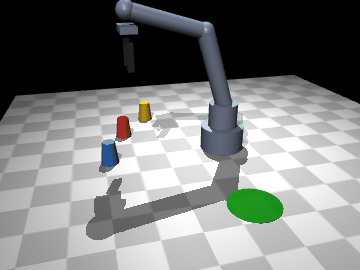
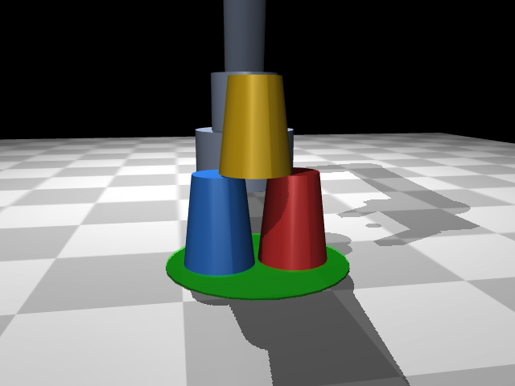

# Bài: Xếp 3 cốc thành kim tự tháp





Cánh tay robot gắp lần lượt 3 cốc đang úp rải rác trên bàn và xếp chúng thành kim tự tháp:

```
        [ C3 ]          tầng 2: vành miệng C3 tựa lên đáy của C1 và C2
     [ C1 ][ C2 ]       tầng 1: 2 cốc úp cạnh nhau, cách nhau 4 mm
```

Bài này nối tiếp [bài gắp đồ](../bai_gap_do/). Cánh tay, IK (`GiaiIK`) và hàm nội suy (`muot`, `nlerp`) được **import lại** từ `../bai_gap_do/gap_do.py`, nên ở đây chỉ tập trung vào phần mới.

## Chạy thử

```bash
pip install -r ../bai_gap_do/requirements.txt
python xep_coc.py                  # chạy headless, in kết quả
python xep_coc.py --xem            # mở viewer
python xep_coc.py --ngau-nhien 5   # rải 3 cốc ở vị trí ngẫu nhiên
MUJOCO_GL=egl python xep_coc.py --gif   # xuất xep_coc.gif + kim_tu_thap.png
```

Kết quả mẫu:

```
  C1 di_chuyen  | cốc C1 z=0.252 m
  C1 rut_len    | cốc C1 z=-0.000 m
  ...
  C3 rut_len    | cốc C3 z=0.090 m
Chờ 2 s kiểm tra độ vững...

Kết quả:
  C1: ở [ 0.014  0.42  -0.   ], lệch  1.4 mm, nghiêng  0.0 độ -> ĐẠT
  C2: ở [ 0.088  0.42  -0.   ], lệch  0.6 mm, nghiêng  0.0 độ -> ĐẠT
  C3: ở [0.052 0.42  0.09 ], lệch  2.2 mm, nghiêng  0.0 độ -> ĐẠT
Kim tự tháp: ĐẠT
```

Đã kiểm chứng:

- `--ngau-nhien` 1 đến 20: đạt **20/20**.
- Lực đỡ cốc trên chia gần đều cho 2 cốc dưới: 0.138 N + 0.157 N ≈ trọng lượng 0.294 N. Tức là C3 tựa thật lên cả hai cốc, không phải cân bằng may mắn trên một cốc.
- Đẩy ngang C3 với lực 0.05 N trong 0.5 s: tháp vẫn đứng.

| File | Nội dung |
|---|---|
| `xep_coc.xml` | Cánh tay (giống bài trước) + 3 cốc hình nón cụt |
| `xep_coc.py` | Tính vị trí kim tự tháp, lập kế hoạch 3 cốc × 8 bước, kiểm tra kết quả |

---

## 1. Model cái cốc

```xml
<mesh name="coc" vertex="0.035 0 0  ...  0.025 0 0.09 ..."/>
```

Mesh chỉ gồm các đỉnh của 2 đường tròn: miệng (r = 3.5 cm, z = 0) và đáy (r = 2.5 cm, z = 9 cm). MuJoCo tự dựng **bao lồi** (convex hull) từ các đỉnh này, nên ta được một hình nón cụt.

- Cốc được khai báo **úp ngược** sẵn: miệng ở dưới, gốc toạ độ của body nằm ở tâm vành miệng. Nhờ vậy `xpos` của cốc chính là điểm chạm sàn, rất tiện khi tính vị trí đặt.
- Va chạm mesh trong MuJoCo **luôn dùng bao lồi**, nên cốc là khối đặc chứ không rỗng. Với bài này điều đó không ảnh hưởng, vì ta chỉ kẹp mặt ngoài và chồng các cốc úp. Nếu muốn lồng cốc vào nhau thì phải ghép cốc từ nhiều mảnh lồi.
- **Số điểm tiếp xúc:** một mặt phẳng tựa lên mặt phẳng khác cần ít nhất 3 điểm tiếp xúc thì mới đứng vững; nếu chỉ có 1 điểm, vật sẽ lắc lư. MuJoCo 4.x tự sinh nhiều điểm cho trường hợp này: đo được 4 điểm giữa mỗi cốc và sàn. Ở MuJoCo 3.x, nếu thấy cốc lắc lư khi chồng, hãy thêm `<flag multiccd="enable"/>` vào trong `<option>`.

## 2. Hình học kim tự tháp

```python
nua = R_MIENG + KHE / 2            # 3.5 cm + 2 mm
c1 = tam - nua * huong_hang        # tầng dưới, bên trái
c2 = tam + nua * huong_hang        # tầng dưới, bên phải
c3 = tam + [0, 0, CAO]             # tầng trên, đặt ở độ cao 9 cm
```

Vì sao cốc trên đứng được? Vành miệng C3 là đường tròn bán kính 3.5 cm quanh tâm tháp. Tâm đáy của C1 và C2 cách tâm tháp 3.7 cm. Như vậy vành C3 đi qua sát tâm đáy của 2 cốc dưới, mà mỗi mặt đáy có bán kính 2.5 cm, nên C3 tựa trọn lên 2 mặt phẳng.

Khe 4 mm giữa C1 và C2 giúp C2 khi hạ xuống không cọ vào C1. Nếu cọ, ma sát sẽ kéo lệch C1.

## 3. Chọn hướng kẹp để ngón không đụng cốc bên cạnh

Cốc đối xứng tròn nên kẹp theo hướng nào cũng được. Điểm cần chú ý nằm ở bước **đặt**:

- Nếu 2 ngón đóng theo hướng của hàng cốc (trục x), khi đặt C2 sát C1 thì một ngón sẽ chen vào giữa 2 cốc. Khe chỉ có 4 mm, trong khi ngón dày 1.6 cm, nên ngón đâm vào C1.
- Vì vậy ta cho ngón đóng theo trục y, **vuông góc với hàng cốc**. Hai ngón khi đó nằm phía trước và phía sau cốc, không đụng cốc bên cạnh.

```python
huong_hang = [1, 0, 0]   # hàng cốc theo trục x
y_kep      = [0, 1, 0]   # ngón đóng theo trục y
```

## 4. Chọn độ cao kẹp

| Thông số | Giá trị | Lý do |
|---|---|---|
| `Z_KEP` | 4.5 cm trên vành miệng | Gần trọng tâm cốc (4.0 cm). Kẹp ngang trọng tâm thì trọng lực không tạo mô-men làm cốc xoay quanh trục nối 2 điểm kẹp. |
| Đầu ngón | cách vành 2.5 cm | Không chạm sàn khi gắp. Khi đặt C3, ngón cũng không chạm đáy C1/C2 (đầu ngón ở ~11.8 cm, đáy C1/C2 ở 9 cm). |
| `Z_DI` | 30 cm | Cốc đang cầm (vành ở ~25 cm) đi cao hơn đỉnh tháp (18 cm). |
| `THA_CAO` | 3 mm | Thả khi cốc còn cách mặt đỡ 3 mm để không ép cốc vào mặt đỡ. Cốc rơi 3 mm thì vẫn đứng yên. |

## 5. Kế hoạch: 3 cốc × 8 bước

Mỗi cốc đi qua đúng 8 bước như bài gắp đồ: `toi_tren → ha_xuong → kep → nhac_len → di_chuyen → ha_dat → tha → rut_len`. Hàm `lap_ke_hoach` chỉ việc ghép 3 chuỗi đó lại, mỗi chuỗi với một vị trí nguồn và một vị trí đích khác nhau.

**Thứ tự xếp rất quan trọng:** C1 và C2 phải xếp trước, C3 sau. Bước `ha_dat` của C3 được cho chậm hơn (1.8 s) để vành cốc chạm 2 đáy thật nhẹ nhàng.

## 6. Kiểm tra kết quả

Sau khi tay rút lên, mô phỏng tiếp **2 giây** rồi mới đánh giá. Một chồng cốc có thể đứng ngay lúc thả nhưng đổ sau đó, nên phải chờ. Mỗi cốc phải thoả:

- lệch vị trí mong muốn < 6 mm,
- trục cốc nghiêng < 3° (cốc không bị đổ).

---

## 7. Bài tập

1. **Tháp 6 cốc** (3-2-1): viết lại `vi_tri_kim_tu_thap` cho N tầng. Tay có đủ tầm với tầng 3 không (đỉnh ở 27 cm)? Cần tăng `Z_DI` lên bao nhiêu?
2. **Giới hạn khe:** trước khi chạy, tính bằng tay xem `KHE` lớn đến mức nào thì vành C3 (bán kính 3.5 cm) không còn tựa lên đáy C1, C2 (bán kính 2.5 cm) mà lọt xuống giữa. Sau đó tăng `KHE` dần trong code để kiểm chứng.
3. **Giảm khe** `KHE` về 0, rồi thử một giá trị âm. Khi các cốc cọ vào nhau thì sao?
4. **Kẹp sai độ cao:** đặt `Z_KEP = 0.08` (gần đáy cốc). Quan sát cốc xoay trong kẹp lúc di chuyển và giải thích bằng mô-men trọng lực.
5. **Cốc ngửa:** đổi mesh thành cốc ngửa (miệng ở trên), rồi xếp C3 ngửa lên miệng của C1, C2. Vì cốc là khối đặc (bao lồi) nên phép xếp này dễ hay khó hơn so với cốc rỗng ngoài đời thật?
6. **Vòng kín:** trước khi đặt C3, đo lại vị trí thực của C1 và C2, rồi đặt C3 vào giữa 2 vị trí thực đó thay vì vị trí dự kiến.
